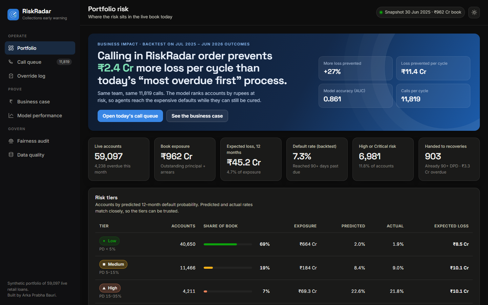
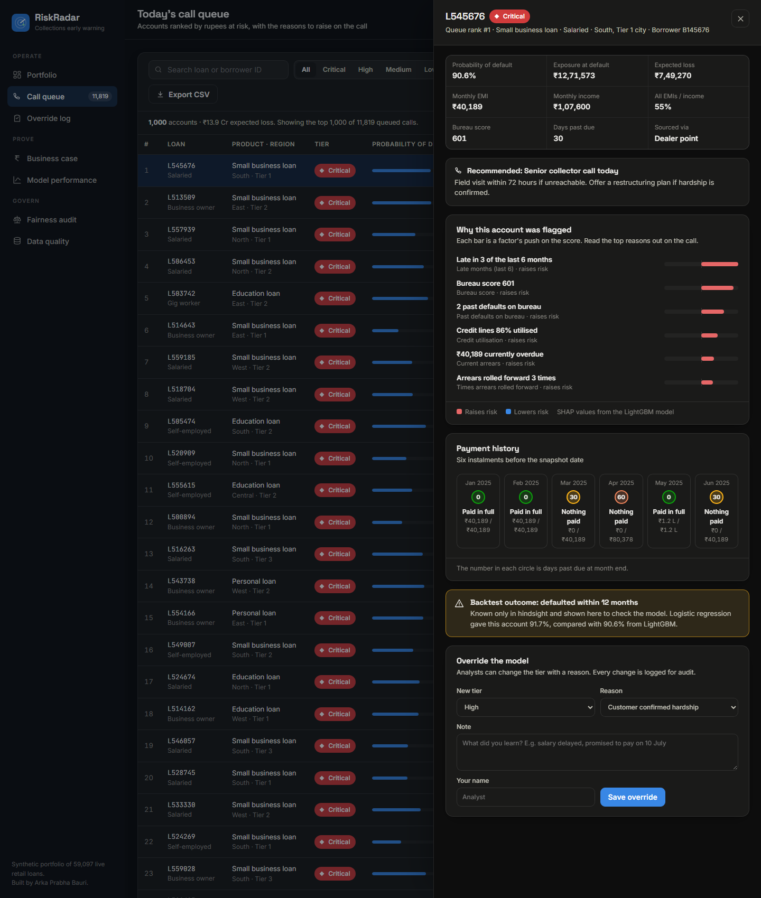
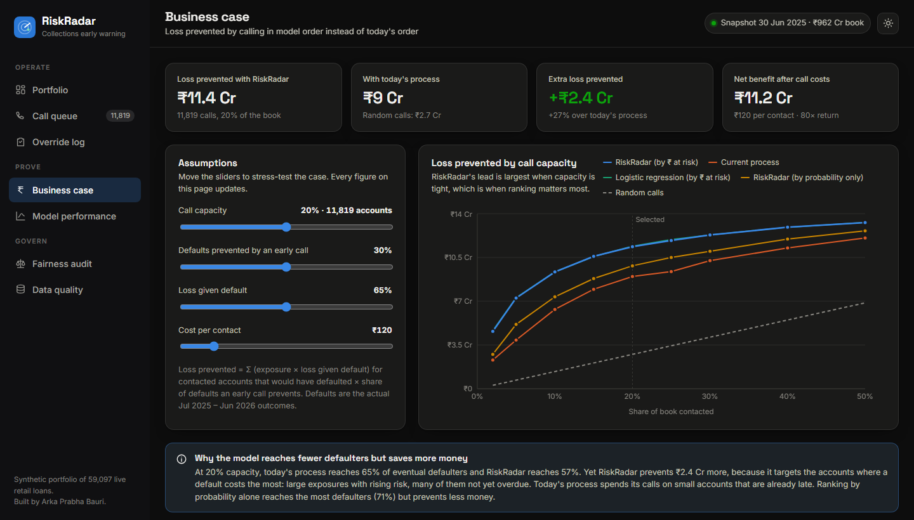
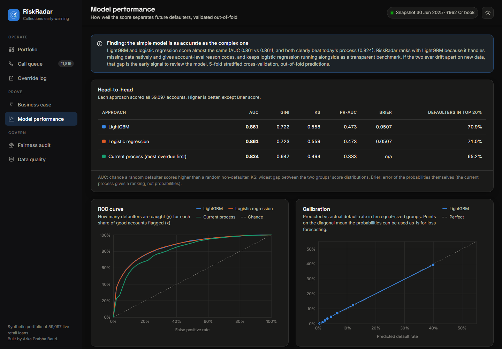
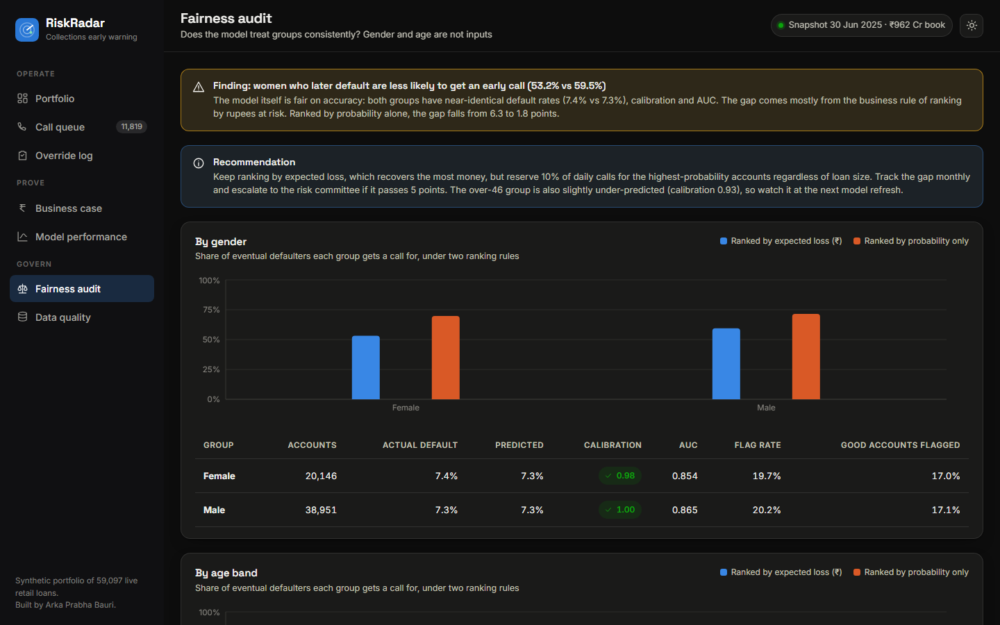

# RiskRadar: who should collections call first?

**A credit-risk early-warning system that ranks a lender's live loan book by rupees at risk, explains every flag in plain language, and proves its value against the current process.**



> **Result:** with the same team and the same 11,819 calls, calling in RiskRadar order prevents **₹2.4 crore more credit loss per cycle (+26.5%)** than today's "most overdue first" order, in a backtest on 59,097 loans worth ₹962 crore.

---

## Why this project

Collections teams can only call a fraction of their book. Most call whoever is most overdue, which is too late (half of next year's defaulters aren't overdue yet) and blind to how much is at stake. RiskRadar answers three questions a collections head actually asks:

1. **Who do we call today, and in what order?** Ranked by expected loss = probability of default × exposure × loss given default.
2. **What should the agent say?** The top three reasons, in sentences, for every account.
3. **Can we trust it?** Out-of-fold validation, calibration by tier, a fairness audit, data-quality checks and an override audit trail.

## Key findings

| | |
|---|---|
| 💰 **+₹2.4 Cr per cycle** | Loss prevented rises from ₹9.0 Cr to ₹11.4 Cr at 20% call capacity. At 5% capacity the lead is +86% |
| 🎯 **Fewer defaulters, more money** | RiskRadar reaches 57% of defaulters vs 65% today, but prevents more loss because it targets large, deteriorating accounts. 51% of its queue isn't overdue yet |
| ⚖️ **The simple model tied the complex one** | Logistic regression and LightGBM both reach AUC 0.861 vs 0.824 for the current process. Reported as-is |
| 📏 **Probabilities are trustworthy** | Predicted vs actual default rate within 7% in every tier |
| 🔍 **Fairness audit found a real gap, and its cause** | Women who later default get an early call 6.3 points less often. Ranked by probability alone the gap is 1.8 points, so the cause is the ₹-based business rule, not the model. Mitigation proposed |

Full write-up: **[docs/case_study.md](docs/case_study.md)**

## What's inside

| Layer | What it does | Where |
|---|---|---|
| **Business analysis** | Requirements document, process maps (current vs future), assumptions log, data dictionary | [`docs/`](docs) |
| **Data** | Synthetic Indian retail-lending portfolio: 5 related tables, realistic underwriting rules and deliberate data-quality issues | [`pipeline/generate_data.py`](pipeline/generate_data.py) |
| **SQL** | Schema, 10 data-quality checks, cleaning, and 33 features built with window functions (`ROW_NUMBER`, `LAG`) | [`sql/`](sql) |
| **Model** | Logistic regression vs LightGBM, 5-fold out-of-fold validation, SHAP reason codes, fairness audit, business-case simulation | [`pipeline/train_model.py`](pipeline/train_model.py) |
| **Dashboard** | React + TypeScript + Recharts: portfolio, call queue, borrower drill-down, overrides, business case, model, fairness, data quality | [`dashboard/`](dashboard) |

## Screenshots

| Call queue with reasons and override | Interactive business case |
|---|---|
|  |  |

| Model validation | Fairness audit |
|---|---|
|  |  |

## Run it

Requires Python 3.11+ and Node 18+.

```bash
# 1. Data → SQL → model → dashboard JSON (about 1 minute)
python -m venv .venv
.venv\Scripts\activate            # macOS/Linux: source .venv/bin/activate
pip install -r requirements.txt
python run_pipeline.py

# 2. Dashboard
cd dashboard
npm install
npm run dev                       # http://localhost:5173
```

`npm run build` produces a static site in `dashboard/dist/` that can be hosted on GitHub Pages or Vercel as-is.

## Design decisions

- **Rank by expected loss, not probability.** A 60% chance of losing ₹45,000 matters less than a 25% chance of losing ₹12 lakh.
- **Exclude accounts already 90+ DPD.** They've already defaulted and go to recoveries, not an early-warning queue.
- **Out-of-fold scoring everywhere.** Every number in the dashboard comes from a model that never saw that loan during training.
- **Protected attributes are blocked in code.** The pipeline asserts that gender and age are not features, then uses them only to audit outcomes.
- **Every assumption lives in one file.** [`pipeline/config.py`](pipeline/config.py), and the four business assumptions can be changed live on the dashboard.

## About the data

The portfolio is synthetic because real Indian lending data is confidential and the public Home Credit dataset needs a Kaggle login. It's generated to behave like the real thing: bureau scores, a 55% FOIR underwriting cap, income shocks, gig-worker risk and messy raw feeds. See [docs/assumptions.md](docs/assumptions.md). Swapping in real data means changing only the loader and SQL column names.

## Tech

Python · pandas · scikit-learn · LightGBM · SHAP · SQLite · React 18 · TypeScript · Vite · Recharts

---

Built by **Arka Prabha Bauri** · B.Tech ECE, BIT Mesra · [github.com/Arzentavis](https://github.com/Arzentavis)
