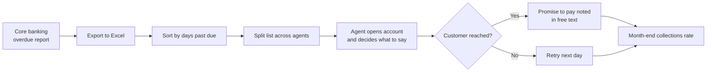
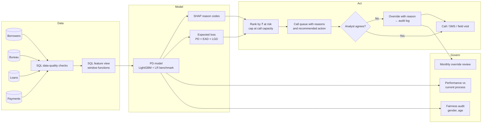

# Process flow

## Today: "most overdue first"

**Pain points**
- Accounts that are current but deteriorating never appear until they miss a payment.
- A ₹45k loan and a ₹12L loan at the same DPD get equal priority.
- No record of why agents skipped or re-prioritised accounts.

## Future: RiskRadar

## Action by tier

| Tier | PD band | Action | Owner | SLA |
|---|---|---|---|---|
| Critical | ≥ 35% | Senior collector call; field visit if unreachable; restructuring offer if hardship confirmed | Senior collector | Same day |
| High | 15–35% | Call, agree a payment date, send a UPI payment link | Agent | 48 hours |
| Medium | 5–15% | SMS + IVR reminder 3 days before due date; call if next EMI is missed | Automated | Before due date |
| Low | < 5% | Standard reminders only | n/a | n/a |
